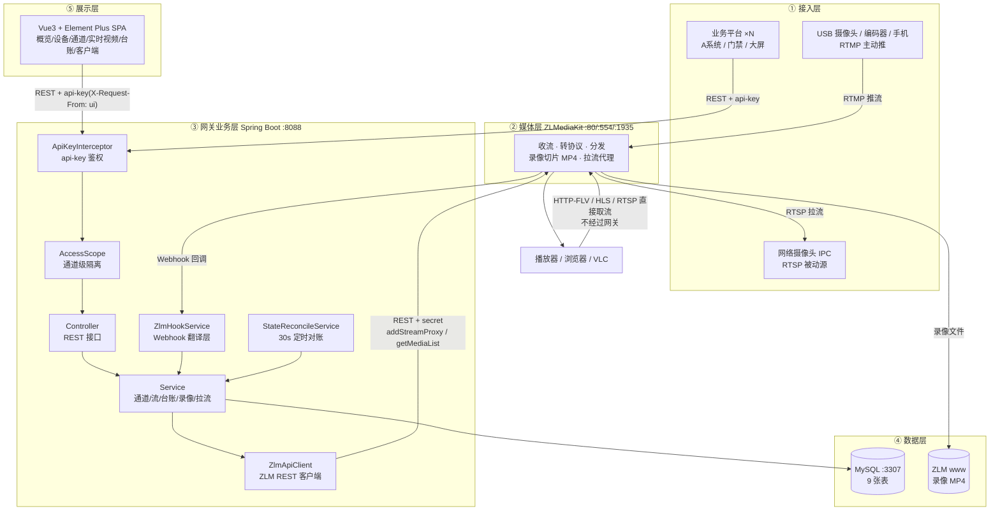
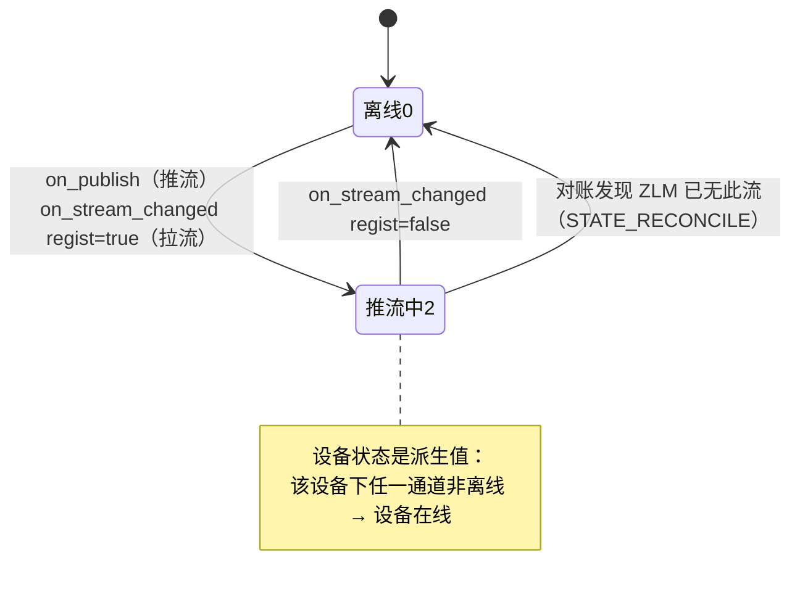
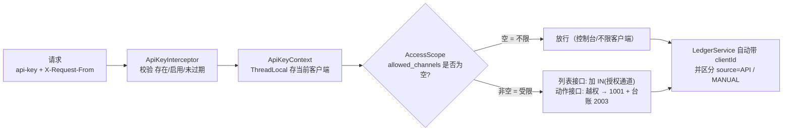
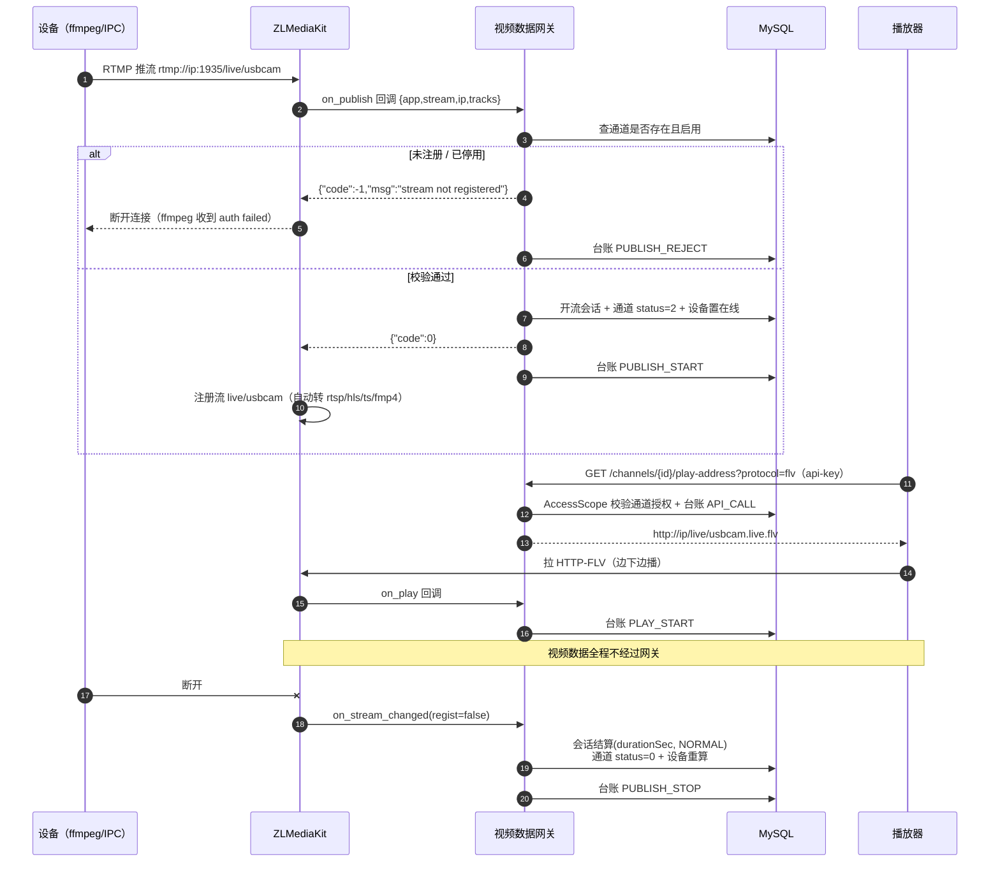
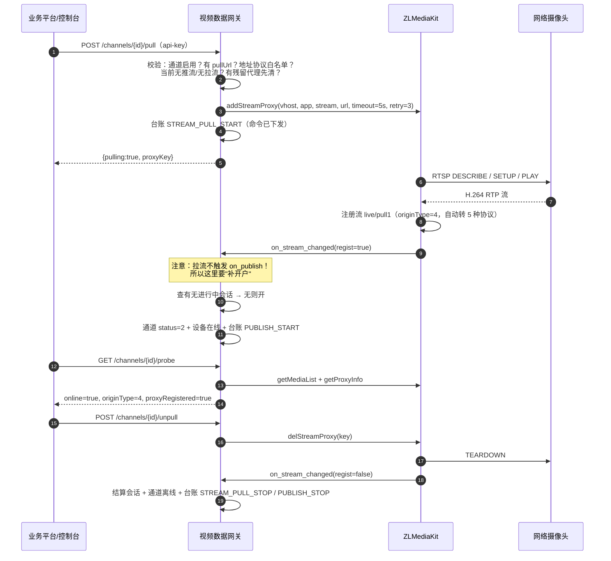
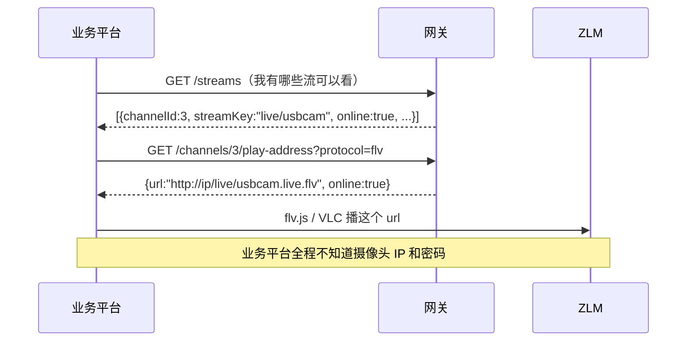
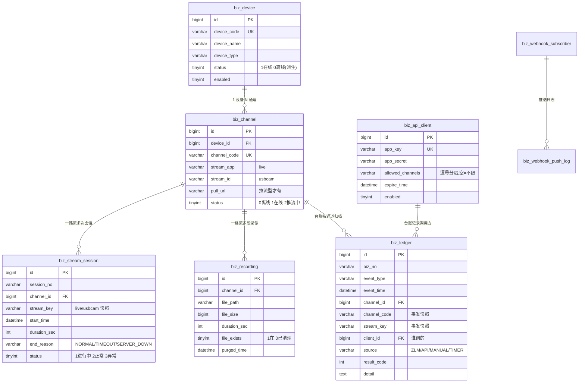

# 系统架构图（分层 / 数据流 / 业务逻辑 / 推流与拉流）

> 配套文档：`10-通道级隔离与平台拉流.md`（设计细节）、`11-接口使用手册.md`（接口）、`05-数据库设计说明.md`（表结构）
> 渲染说明见文末「怎么把这些图变成 PPT 里的图」。

---

## 一、一张图看懂整体

```
================= ① 接入层：设备侧 / 业务方 =================
   网络摄像头 IPC ──┐
   USB 摄像头+ffmpeg ┤── 推流 RTMP ──►   ┌──────────────────┐
   编码器 / 手机 App ┘                    │                  │
                                           │   ② 媒体层        │   一套流 → 五种协议
   网络摄像头 IPC ────── RTSP ──►（平台去拉）│   ZLMediaKit      │   RTMP / RTSP / HTTP-FLV / HLS / WebRTC
                                           │  收流·转协议·分发  │
                                           │  录像切片(MP4)     │
                                           └───────┬──────────┘
                                                   │ Webhook 回调（POST，JSON，2~5KB）
   业务平台 ×N ─── REST + api-key ──►  ┌───────────▼──────────────┐
   （A系统 / 门禁 / 大屏 / 控制台）      │   ③ 网关业务层            │  Java 不碰视频数据
                                       │  Spring Boot 3.3.5        │  ← 不转发视频！只发号施令
                                       │  Controller→Service→Mapper │
                                       │  集成层：ZLM REST 客户端    │
                                       └───────────┬──────────────┘
                                                   │ MyBatis-Plus
                                       ┌───────────▼──────────────┐
                                       │   ④ 数据层                │
                                       │  MySQL 8.0.28（9 张表）    │
                                       │  ZLM www 目录（录像 MP4）  │
                                       └──────────────────────────┘

   播放器 / 浏览器 / VLC  ◄──────────── 直接从 ZLM 取流（不经过网关）
```

**一句话总结**：**控制信令走网关，视频数据走媒体服务器。** 网关是"发号施令 + 记账"的，不是"搬运视频"的。

---

## 二、五种分层职责

| 层 | 组件 | 负责 | **明确不负责** |
|---|---|---|---|
| ① 接入层 | IPC / USB 摄像头 / 编码器 / 手机 / 业务平台 | 采集画面；或发起业务调用 | 不做协议转换、不做权限 |
| ② 媒体层 | ZLMediaKit（80 / 554 / 1935） | 收流、转协议、分发、录像切片、无人观看自动关流 | 不懂业务、不懂权限、不记业务账 |
| ③ 网关业务层 | Spring Boot 3.3.5 + MyBatis-Plus | 主数据台账、凭证发放、鉴权与隔离、**Webhook 事件翻译成台账/会话/状态**、播放地址签发、拉流下发 | **不转发视频流**、不做转码 |
| ④ 数据层 | MySQL 8.0.28（3307）+ ZLM www | 业务台账、会话、录像记录、订阅与推送日志 | 不存视频文件本身（MP4 在 www 目录） |
| ⑤ 展示层 | Vue 3 + Element Plus（本地 vendor，无构建） | 概览 / 视频资源 / 实时视频 / 业务台账 / API 客户端 / 接口文档 | 不直接访问数据库、不直连 ZLM |

---

## 三、数据怎么传输（三条通道，别混）

| 通道 | 协议 | 方向 | 流量 | 频率 |
|---|---|---|---|---|
| **媒体流** | RTMP / RTSP / HTTP-FLV / HLS / WebRTC | 设备 → ZLM → 播放器 | **大**（1080p ≈ 2~4 Mbps） | 持续 |
| **控制面 REST** | HTTP/JSON + `api-key` 头 | 业务平台 ↔ 网关 | 小（几 KB） | 按需 |
| **事件回调 Webhook** | HTTP POST/JSON | ZLM → 网关 | 小（2~5 KB） | 每次推/断/播/录 |

**关键设计**：媒体流永远不经过 Java。所以 10 个客户端同时看同一路流，网关的负载不增加（ZLM 内部做 fan-out：一路进，多路出）。

---

## 四、架构图（Mermaid，可视化版）



---

## 五、业务逻辑：三条不变式

### 5.1 状态机（通道 / 设备 / 会话）



| 对象 | 字段 | 取值 | 谁改它 |
|---|---|---|---|
| 通道 | `status` | 0 离线 / 1 在线（预留）/ 2 有流在跑（**界面统一显示"在线"**） | Webhook 事件 + 对账任务 |
| 设备 | `status` | 1 在线 / 0 离线 | **派生计算**（任一通道非离线 = 在线） |
| 流会话 | `status` | 1 进行中 / 2 正常结束 / 3 异常结束 | 开户时建、断流时结算 |

### 5.2 事件驱动 + 定时对账（最终一致）

```
实时性：Webhook 事件（推流/断流/播放/录像）→ 立刻改状态、写台账
兜底：  @Scheduled 每 30 秒 → 拿 ZLM 真实流列表与 DB 对比
        · DB 说推流中、ZLM 没有 → 置离线 + 结算会话 + 台账 STATE_RECONCILE(source=TIMER)
        · ZLM 有流、DB 不是推流中 → 补登状态
```

**为什么两者都要**：事件可能丢（网关重启、ZLM 重试次数用完、推流进程被 kill）。只有事件 → 会留僵尸状态；只有轮询 → 状态滞后且浪费。两者配合才叫"外部系统的状态可信"。

### 5.3 鉴权与隔离链（每个请求都走同一条链）



三个价值点：**一份判定**（AccessScope 静态工具，6 个服务复用，不会漏）、**越权留痕**（拒绝也记台账）、**身份自动落账**（业务代码不需要显式传 clientId）。

---

## 六、推流链路（设备主动推）

### 6.1 时序图



### 6.2 文字版（背这个就够讲）

```
设备 → RTMP:1935 → ZLM
    ↓ Webhook on_publish（网关的唯一拦口：这路流注册过吗？启用了没？）
    ├─ 不通过 → 回 {"code":-1} → ZLM 断开 → 台账 PUBLISH_REJECT
    └─ 通过   → 开流会话 + 通道「在线」+ 设备在线 + 台账 PUBLISH_START
    ↓
播放器 → play-address（换地址）→ 直接向 ZLM 拉流 → 台账 PLAY_START
    ↓
断流 → on_stream_changed(regist=false) → 结算会话 + 通道离线 + 台账 PUBLISH_STOP
```

### 6.3 推流的三个特点

1. **设备是主动方**，网关无法"叫设备推"，只能"允不允许它推"
2. **鉴权点是 `on_publish`** —— 唯一能拒绝推流的地方（返回非 0 即断）
3. 一路流进来，ZLM 自动生成 5 种协议出口，下游想用哪个用哪个

---

## 七、拉流链路（平台主动去拉）

### 7.1 为什么需要拉流

网络摄像头（IPC）通常**只提供 RTSP，不会主动连你**。没有拉流能力，网关就接不进一台真正的摄像头。
推流是"你来"，拉流是"我去"，这是两种设备性格。

### 7.2 时序图



### 7.3 推流 vs 拉流对照表

| | 推流 Push | 拉流 Pull |
|---|---|---|
| 谁发起 TCP 连接 | 设备 → 平台 | 平台 → 设备 |
| 典型设备 | USB 摄像头+ffmpeg、编码器、手机 App | IPC、NVR、其它流媒体服务器 |
| 建通道时 | `pullUrl` **留空** | `pullUrl` 填 `rtsp://user:pass@ip:554/...` |
| 之后要不要操作 | 不用，设备一推就上线 | **必须** `POST /channels/{id}/pull` |
| ZLM 侧实现 | 无需调用，直接收 | `addStreamProxy` / `delStreamProxy` |
| 鉴权方向 | 平台验设备（`on_publish` 拒绝未注册流） | 设备验平台（RTSP 用户名密码） |
| 上线走哪个回调 | `on_publish` → `on_stream_changed` | **只有** `on_stream_changed`（要补开户） |
| 台账命令层事件 | 无（设备自己发起的） | `STREAM_PULL_START` / `STREAM_PULL_STOP` |
| 失败典型现象 | 设备收到 auth failed | `3001 拉流失败：连不上拉流地址` |
| 排查手段 | `probe` 看 `originName=推流` | `probe` 看 `originName=拉流` + `proxyRegistered` |

**互斥规则**：同一个 `app/stream` 不能既推又拉（流标识会被两路源争抢），网关在下发前会拦。

### 7.4 拉流的两个坑（都踩过并修好）

| 现象 | 原因 | 修法 |
|---|---|---|
| `This stream already exists` | ZLM `retry_count` 默认 -1（无限重试），拉不通时代理留在服务器上但流没注册 | 显式 `retry_count=3`、`timeout_sec=5`；下发前 `getProxyInfo` 清残留 |
| `媒体服务器不可达: Read timed out` | ZLM 下发时阻塞地连源地址，我们 10s 读超时先回来了，代理可能已注册成功 | 超时后先查代理：在 → 按"已下发未上线"处理；不在 → 才报失败 |

---

## 八、业务平台"看视频"的最小链路（对接方只需这两步）



---

## 九、数据模型（9 张表）



| 表 | 关键设计 |
|---|---|
| `biz_ledger` | **append-only** 审计账；`channel_code`/`stream_key` 是**事发快照**，通道改名/删除后历史不失真 |
| `biz_stream_session` | 一次推/拉流一行，断流时结算 `duration_sec`，用于"设备在线时长"统计 |
| `biz_recording` | 清文件只置 `file_exists=0` 并记 `purged_time`，**记录不删** |
| `biz_api_client` | `allowed_channels` 是通道级隔离的落点，空 = 不限 |
| `biz_play_session` / `biz_webhook_*` | 已建表，本期未启用（播放会话合并、出口推送） |

---

## 十、端口与外部依赖清单

| 组件 | 端口 | 用途 |
|---|---|---|
| ZLMediaKit | **80** | HTTP API、HTTP-FLV、HLS、WebRTC |
| ZLMediaKit | **554** | RTSP |
| ZLMediaKit | **1935** | RTMP（推流/拉流） |
| ZLMediaKit | 443 | HTTPS（未启用） |
| ZLMediaKit | 9000 / 10000 | GB28181 RTP 收流 |
| 视频数据网关 | **8088** | REST API + 前端静态页 + Knife4j 文档 |
| MySQL | **3307** | 业务库（3306 被公司服务占用） |
| ffmpeg | — | 推流测试（`scripts\push-*.bat`） |

---

## 十一、怎么把这些图变成 PPT 里的图

文档里的图是 **Mermaid** 语法，三种渲染方式任选：

| 方式 | 怎么做 |
|---|---|
| **在线最快** | 打开 [mermaid.live](https://mermaid.live) → 把代码块内容粘进去 → 右侧直接出图 → 右上角「Actions → PNG/SVG」下载 |
| **VS Code / IDEA** | 装 Mermaid 插件（VS Code: `Markdown Preview Mermaid Support`；IDEA: 内置 Markdown 支持 Mermaid）→ 直接预览 Markdown → 右键导出 |
| **GitHub / 语雀 / 飞书** | 直接把 `.md` 粘进去，代码块会渲染成图 |

答辩建议：**架构图 + 推流/拉流两张时序图** 这三张必须放，其余按时间挑选。